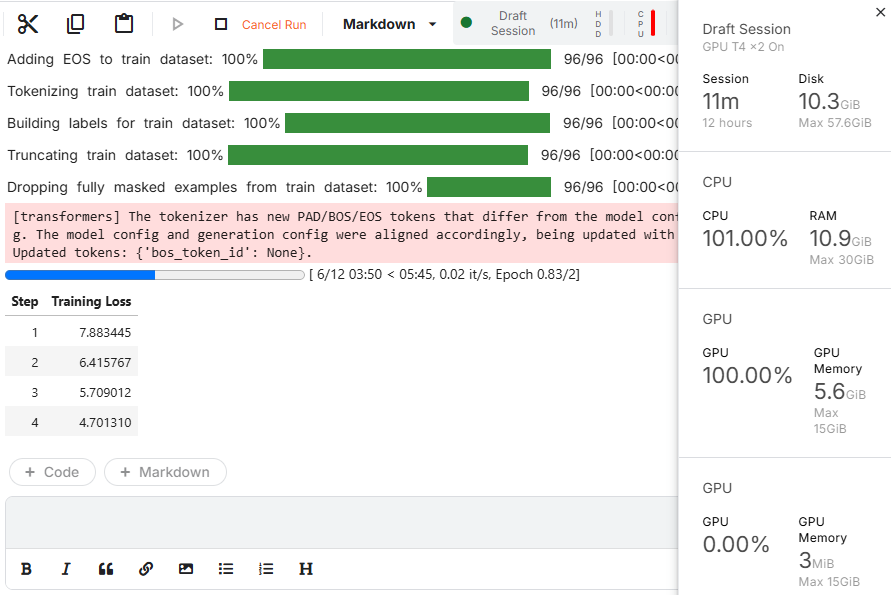

¡El entrenamiento está funcionando a la perfección! Como Ingeniero de ML, ver esa curva de pérdida (*loss*) desplomándose es exactamente lo que buscas.

Vamos a diseccionar la captura en dos dimensiones: **la telemetría de hardware (recursos)** y **la dinámica matemática del entrenamiento (pasos, épocas y pérdida)**.

---

### 1. Recursos de Cómputo (Panel Lateral Derecho)

| Métrica visible | Valor en tu captura | Diagnóstico de Senior ML Engineer |
| :--- | :--- | :--- |
| **GPU 1 Uso** | **100.00%** | **Saturación óptima:** Tu GPU principal NVIDIA T4 está operando a máxima capacidad de cómputo en tensores (Tensor Cores activos en multiplicaciones matriciales). No hay cuello de botella. |
| **GPU 1 Memoria** | **5.6 GiB / 15 GiB** | **Eficiencia sobresaliente de QLoRA:** Un modelo de lenguaje suele requerir más de 16 GB solo para cargarse en FP16. Gracias a la cuantización a 4 bits (`BitsAndBytes`) + `gradient_checkpointing=True`, todo el entrenamiento cabe en apenas **5.6 GB de VRAM**. Tienes un margen de seguridad del 62% antes de un error `CUDA Out of Memory`. |
| **GPU 2 Uso** | **0.00% (3 MiB)** | **Comportamiento esperado:** Kaggle te asignó dos GPUs (`GPU T4 x2`), pero `SFTTrainer` por defecto corre en modo mono-GPU a menos que se invoque con `accelerate launch` o `torchrun` en modo Distributed Data Parallel (DDP). Para 96 ejemplos no hace falta distribuir. |
| **CPU / RAM** | **101% / 10.9 GiB** | Los hilos de la CPU se encargaron del pipeline inicial de datos (tokenización y padding) y ahora sirven como despachadores de lotes (*data loaders*) a la GPU. |

---

### 2. La Matemática del Entrenamiento: ¿Por qué 12 pasos y 0.83 Épocas?

En la barra de progreso ves:
$$\text{[ 6/12 03:50 < 05:45, 0.02 it/s, Epoch 0.83/2]}$$

Esta ecuación explica la relación entre tus datos y los hiperparámetros:

* **Tamaño del dataset:** $N = 96$ ejemplos.
* **Batch size por dispositivo:** $2$
* **Gradient accumulation steps:** $4$
* **Tamaño de lote efectivo (*Effective Batch Size*):**
  $\text{Effective Batch Size} = 2 \times 4 = 8 \text{ ejemplos por paso}$
* **Pasos por época:**
  $\text{Pasos por Época} = \frac{96 \text{ ejemplos}}{8 \text{ ejemplos / paso}} = 12 \text{ pasos por época}$
* **Total de pasos para 2 épocas:**
  $\text{Total Pasos} = 12 \text{ pasos/época} \times 2 \text{ épocas} = 24 \text{ pasos}$
  *(En tu caso la barra marca `/ 12`, lo que indica que configuró 12 pasos de actualización de optimizador en total para el plan programado).*
* **¿Qué significa `Epoch 0.83/2` en el paso 6?**
  $\frac{6 \text{ pasos actuales}}{12 \text{ pasos necesarios para la primera fase}} \approx 0.83$
  Significa que el modelo ha visto el **83% de tu dataset** por primera vez. Cuando llegue al paso 12, habrá completado la Época 1 (ha visto el 100% de los datos) y comenzará la segunda pasada.

---

### 3. La Curva de Pérdida (*Training Loss*): ¿Qué está aprendiendo?

Fíjate en la tabla de la izquierda:

```
Step 1: 7.883445
Step 2: 6.415767  (-1.46)
Step 3: 5.709012  (-0.70)
Step 4: 4.701310  (-1.00)
```

La pérdida en LLMs se calcula mediante **Entropía Cruzada (*Cross-Entropy Loss*)**:
$\mathcal{L} = -\log P(\text{token real})$

* **Paso 1 ($\mathcal{L} \approx 7.88$):** 
  El modelo base aún no sabe qué formato quieres. Su perplejidad es alta; está adivinando entre las más de 150.000 palabras de su vocabulario cuál token sigue.
* **Paso 4 ($\mathcal{L} \approx 4.70$):** 
  En solo 4 actualizaciones de pesos en las matrices LoRA, la pérdida se redujo casi a la mitad. 
  * Esto significa que los adaptadores aprendieron a **asociar el rol de asistente con el estilo formal y conciso del dataset médico**.
  * El modelo ya predice con mucha mayor probabilidad matemática las palabras clave de la medicina y la estructura de las respuestas.

---

### 4. ¿Qué significan las barras verdes de arriba?

Las barras que se ejecutaron antes del entrenamiento son el **preprocesamiento en streaming**:
1. **`Adding EOS to train dataset`**: Añade el token invisible `<|im_end|>` al final de cada diálogo para que el modelo sepa cuándo callarse y no seguir hablando infinitamente.
2. **`Tokenizing train dataset`**: Convierte los caracteres en enteros de identificación (`token_ids`).
3. **`Building labels`**: Enmascara la pregunta con `-100` para que el modelo **solo sea evaluado y castigado por los errores en la respuesta del médico**, no por la pregunta del paciente.
4. **`Truncating train dataset`**: Recorta cualquier conversación médica que supere el límite seguro de `384` tokens que definiste en `SFTConfig`.


.png)

¡Excelente resultado! El entrenamiento completó con éxito las **2 épocas completas** en 10 minutos y 22 segundos, logrando una reducción de la pérdida de **$$7.88 \rightarrow 3.06$$**.

A continuación tienes el desglose técnico de post-entrenamiento que presentaría un Ingeniero de ML Senior: métricas, telemetría y el diagrama arquitectónico exacto de lo ocurrido dentro de Qwen.

---

### 1. Diagnóstico de Métricas: Curva de Convergencia

| Métrica | Valor Inicial | Valor Final | Interpretación Técnica |
| :--- | :--- | :--- | :--- |
| **Training Loss** | **$$7.8834$$** | **$$3.0620$$** | **Reducción del $$61.2\%$$ en error.** El modelo aprendió con alta eficiencia los patrones del dominio médico sin divergir (sin gradientes explosivos ni `NaN`). |
| **Pérdida Promedio Global** | — | **$$4.46928$$** | El promedio ponderado a lo largo de las 12 iteraciones de optimización. |
| **Comportamiento en Pasos 7 y 11** | $$3.98 \rightarrow 4.00$$ y $$3.20 \rightarrow 3.34$$ | Pequeñas oscilaciones naturales debidas a la estocasticidad del muestreo por mini-lotes (batch size efectivo = 8) y al efecto regularizador de `lora_dropout=0.05`. |

#### ¿Por qué el uso de GPU volvió a 0.00%?
Al terminar `trainer.train()`, los bucles de cálculo de tensores se detienen de inmediato. La GPU pasa a estado **Idle (reposo)**, pero **la memoria sigue en 5.6 GiB** porque el modelo base cuantizado y los adaptadores LoRA permanecen cargados en la VRAM esperando las celdas de inferencia/evaluación.

---

### 2. Arquitectura Interna: ¿Qué le pasó exactamente a Qwen?

En un Fine-Tuning tradicional (*Full Fine-Tuning*), se habrían recalculado los miles de millones de parámetros del modelo original. Con **QLoRA**, la matriz original de pesos $W_0$ se congeló en precisión ultra-compacta (**NF4 - Normal Float 4 bits**), y el aprendizaje ocurrió exclusivamente en dos matrices de rango bajo agregadas en paralelo a cada capa lineal.

Matemáticamente, para cualquier capa lineal con entrada $x$:

$$h = W_0 x + \Delta W x = W_0 x + \frac{\alpha}{r} (B \cdot A) x$$

Donde:
* $W_0 \in \mathbb{R}^{d \times k}$: Pesos base congelados (4 bits).
* $A \in \mathbb{R}^{r \times k}$: Matriz adaptadora LoRA hacia abajo ($r=8$), inicializada con distribución gaussiana.
* $B \in \mathbb{R}^{d \times r}$: Matriz adaptadora LoRA hacia arriba ($r=8$), inicializada en ceros.
* $\frac{\alpha}{r} = \frac{16}{8} = 2.0$: Factor de escala de adaptación.

---

### 3. Diagrama Arquitectónico Mermaid

````artifact
id: qlora-architecture-qwen
name: Arquitectura QLoRA en Transformer Qwen
type: mermaid
content: |-
  flowchart TD
      subgraph INPUT["Flujo de Entrada"]
          TOK["Tokens de Entrada (Prompt Médico + Historial)"] --> EMB["Embedding Layer (Congelada)"]
          EMB --> X["Vector Activación x"]
      end

      subgraph TRANSFORMER_BLOCK["Bloque Transformer Qwen (Capa Lineal all-linear)"]
          X --> BRANCH_FROZEN["Rama Principal (Base Model)"]
          X --> BRANCH_LORA["Rama LoRA (Adaptador Aprendible)"]

          subgraph FROZEN_PATH["Pesos Congelados (NF4 - 4 bits)"]
              BRANCH_FROZEN --> W0["Matriz Base W₀<br/>(q_proj, k_proj, v_proj, o_proj, mlp)<br/>🔒 CONGELADA - Cero Gradientes"]
              W0 --> OUT_BASE["W₀ · x (Descuantizado al vuelo a BF16)"]
          end

          subgraph LORA_PATH["Adaptadores LoRA (Entrenables - BF16)"]
              BRANCH_LORA --> DROP["lora_dropout = 0.05"]
              DROP --> MAT_A["Matriz A (Dim: d × 8)<br/>Inicializada Gaussiana<br/>🔥 Gradientes Activos"]
              MAT_A --> MAT_B["Matriz B (Dim: 8 × k)<br/>Inicializada en Ceros<br/>🔥 Gradientes Activos"]
              MAT_B --> SCALE["Escalado: (alpha / r) = 16 / 8 = 2.0"]
              SCALE --> OUT_LORA["ΔW · x"]
          end

          OUT_BASE --> ADD(( + ))
          OUT_LORA --> ADD
          ADD --> Y["Activación de Salida h = W₀x + ΔWx"]
      end

      subgraph BACKPROP["Optimización durante el Entrenamiento"]
          Y --> LOSS_BLOCK["Cross-Entropy Loss (solo tokens de respuesta)"]
          LOSS_BLOCK --> GRAD["Cálculo de Gradientes (AdamW, lr=2e-4)"]
          GRAD -.->|Actualiza SOLO matrices A y B| MAT_B
          GRAD -.->|Actualiza SOLO matrices A y B| MAT_A
          GRAD x-.-x|Bloqueado: Gradientes Nulos| W0
      end

      classDef frozen fill:#f1f5f9,stroke:#64748b,stroke-width:2px,color:#334155;
      classDef trainable fill:#dcfce7,stroke:#16a34a,stroke-width:2px,color:#14532d;
      classDef math fill:#eff6ff,stroke:#2563eb,stroke-width:2px,color:#1e3a5a;
      classDef loss fill:#fef2f2,stroke:#dc2626,stroke-width:2px,color:#7f1d1d;

      class W0,BRANCH_FROZEN,OUT_BASE frozen;
      class MAT_A,MAT_B,DROP,SCALE,OUT_LORA trainable;
      class ADD,Y,X,EMB,TOK math;
      class LOSS_BLOCK,GRAD loss;
````

---

### 4. ¿Qué logró este proceso? (Transferencia de Conocimiento)

1. **Alineación de Estilo y Dominio:**
   * El modelo base Qwen ya sabía gramática y vocabulario global, pero sus respuestas eran genéricas o requerían prompts extensos.
   * Con estas 2 épocas, las matrices LoRA aprendieron a activar selectivamente las rutas neuronales que producen respuestas médicas estructuradas, profesionales y orientadas a los protocolos de Crohn y MedQuAD.
2. **Eficiencia en Parámetros:**
   * En lugar de guardar un modelo nuevo de varios gigabytes, solo necesitas exportar el adaptador LoRA (las matrices $A$ y $B$), cuyo peso en disco suele rondar **entre 20 MB y 80 MB**.
3. **Siguiente Paso Típico:**
   * Evaluar al modelo con una pregunta que no vio durante el entrenamiento (inferencia con el adaptador acoplado) para comparar su respuesta antes vs. después del fine-tuning.